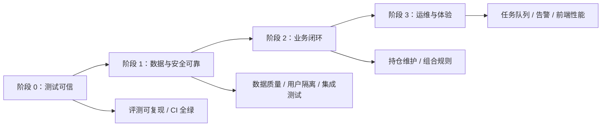

# 个人投资助手改进实施方案

> 文档状态：建议实施
>
> 制定日期：2026-10-06
>
> 适用版本：当前 `develop` 分支

## 1. 背景与现状

项目已经具备可演示、可容器化部署的 MVP：市场、基金和板块数据浏览，规则型投资建议，AI 问答，用户鉴权及 Docker Compose 部署均已实现。

2026 年 9 月，项目完成第一轮受约束型投资 Agent 升级：LLM 只能在服务端定义的工具、参数、权限和预算范围内规划；工具调用经过校验；数据质量不足时可重规划或降级；最终的操作建议和目标仓位由确定性规则引擎生成。

当前主要矛盾不再是“是否具备核心功能”，而是“能否稳定、可验证、可运维地持续使用和迭代”。近期检查结论如下：

| 项目 | 当前情况 | 结论 |
| --- | --- | --- |
| 前端生产构建 | 可成功构建 | 可交付，但产物偏大 |
| 后端自动化测试 | 50 通过、1 失败 | 需要恢复全绿 |
| Agent 离线评测 | 文档记录为 20/20；当前无法稳定复现 | 存在日期依赖问题 |
| 数据采集 | 依赖 AKShare 等公开源 | 需要加强时效、异常处理与监控 |
| 任务执行 | 部分状态仍在进程内 | 不适合多实例和长期运行 |
| 持仓管理 | 支持读取预置持仓 | 缺少用户自主维护闭环 |

失败的离线评测为“陈旧净值重规划”场景。用例内的净值日期固定在 2026 年 9 月，而质量门默认使用运行当天判断时效；时间推移后该数据会被判为过期。因此，评测结果会随真实日期变化，不具备可重复性。

## 2. 目标与非目标

### 2.1 总体目标

将项目从“可演示的 MVP”提升为“可稳定试用、可审计、可持续迭代的个人投资分析系统”。

优先保证以下边界：

1. 数据不足、过期或异常时，系统应明确降级，不能伪装成正常投资结论。
2. 用户只能访问自己的持仓、会话、建议和运行指标。
3. LLM 不能绕过规则引擎直接给出最终仓位或操作裁决。
4. 每次变更都能通过自动化验证，关键问题可被定位、告警和回放。

### 2.2 本期不包含的内容

- 不接入真实交易、下单、资产划转或券商账户。
- 不承诺投资收益，也不将自然语言回答作为投资建议的唯一依据。
- 不在没有验证前扩展无限自主循环的通用 Agent。
- 不将外部数据源的可用性问题简单转移给用户。

## 3. 实施原则

1. **先可靠，后扩展。** 测试、时效判断和数据质量门优先于新增分析指标。
2. **默认保守。** 缺少关键数据、质量不合格或规则结论无法追溯时，只允许“暂不建议操作”或“持有观察”。
3. **确定性决策。** LLM 负责规划和解释；规则引擎负责最终动作、置信度与目标仓位。
4. **可观测优先。** 关键运行必须有指标、日志、错误码和审计轨迹。
5. **小步可验收。** 每个阶段都定义可以自动检查的验收标准，不以“代码已提交”作为完成标准。

## 4. 工作流概览



## 5. 阶段 0：恢复测试可信度

### 5.1 目标

消除时间、环境和外部依赖造成的测试漂移，使本地与 CI 的测试结论一致且可重复。

### 5.2 实施内容

| 编号 | 工作项 | 实施要点 |
| --- | --- | --- |
| T0-1 | 固定评测时间 | 为 `QualityGate.assess` 或评测运行器注入 `today`；每个 fixture 用例声明评测基准日，禁止直接依赖机器当前日期。 |
| T0-2 | 修复失败用例 | 修复 `single_stale_nav_replan`，验证首次结果被识别为陈旧、重规划后的数据被识别为新鲜，最终进入 `ready`。 |
| T0-3 | 自动生成评测报告 | CI 中执行评测并生成报告；报告应包含提交 SHA、执行时间、基准日期、用例数和失败详情。 |
| T0-4 | 统一测试命令 | 明确并维护 `uv sync --extra test`、`uv run pytest -q` 和 `npm run build` 作为最小验证命令。 |
| T0-5 | 处理弃用告警 | 将 Pydantic class-based `Config` 迁移为 `ConfigDict`，避免未来大版本升级阻断测试。 |

### 5.3 验收标准

- 后端测试连续三次运行均为全绿。
- 20 条 Agent 离线用例全部通过，且在不同日期运行结果一致。
- 任一失败用例在报告中可定位到用例 ID、实际结果和失败原因。
- 前端生产构建通过。

## 6. 阶段 1：数据、权限与接口可靠性

### 6.1 数据时效和质量

| 编号 | 工作项 | 实施要点 |
| --- | --- | --- |
| D1-1 | 接入交易日历 | 根据交易日、盘中/盘后和数据类型判断时效，不能只以自然工作日判断。 |
| D1-2 | 完善数据包络 | 所有关键工具结果保留 `source`、`as_of`、`fetched_at`、完整度、质量标记和错误码。 |
| D1-3 | 上游异常策略 | 对超时、限流、字段变更、空数据分别定义重试、退避、熔断和降级策略。 |
| D1-4 | 数据校验 | 对基金代码、净值序列、日期顺序、重复数据、异常涨跌幅及关键字段空值增加校验。 |
| D1-5 | 降级展示 | 前端展示数据时间、缺失项和“恢复正常分析所需条件”，避免只显示泛化错误。 |

### 6.2 权限与接口测试

| 编号 | 工作项 | 实施要点 |
| --- | --- | --- |
| S1-1 | 鉴权集成测试 | 覆盖登录、登出、会话过期、CSRF、限流和管理员权限。 |
| S1-2 | 用户隔离测试 | 覆盖持仓、建议、会话、历史记录和指标接口，验证用户无法越权访问。 |
| S1-3 | SSE 集成测试 | 验证认证失败、取消连接、工具错误、重规划、降级和正常完成事件。 |
| S1-4 | API 契约 | 为核心接口建立请求/响应样例或 OpenAPI 契约测试，防止前后端字段悄然不兼容。 |

### 6.3 验收标准

- 非交易日、节假日和盘后延迟数据都有覆盖测试。
- 关键数据异常不会生成带目标仓位的 `ready` 决策。
- 所有用户范围资源的越权访问测试均返回预期拒绝结果。
- 关键 API、SSE 和数据采集拥有至少一条端到端集成测试。

## 7. 阶段 2：补齐个人投资管理闭环

### 7.1 持仓管理

当前系统能读取持仓，但尚未提供完整的自助维护能力。本阶段新增：

1. 持仓新增、编辑、删除 API 和前端页面。
2. 基金代码、名称、持有份额、成本价、建仓日期、目标仓位等字段校验。
3. 风险偏好、投资期限、单基金上限与行业暴露偏好等用户配置。
4. 变更审计记录；分析时明确使用的持仓快照版本。

### 7.2 组合级规则与解释

在单基金规则稳定后，再扩展组合能力：

- 集中度、行业暴露、风险资产比例和单基金仓位上限检查；
- 组合再平衡建议与“建议原因”的规则化输出；
- 与单基金建议一致的保守降级策略；
- 区分“数据事实”“规则结论”和“LLM 文字解释”的前端展示。

### 7.3 验收标准

- 用户可完整维护自己的持仓，且修改后仅影响其自己的建议。
- 组合建议可以追溯到具体持仓快照、规则版本和数据时间。
- 数据不足时组合建议不输出具体调仓比例。

## 8. 阶段 3：生产化运维与前端体验

### 8.1 任务与可观测性

| 编号 | 工作项 | 实施要点 |
| --- | --- | --- |
| O3-1 | 持久化任务队列 | 将手动刷新、定时采集和长耗时分析从进程内状态迁移至可持久化队列。 |
| O3-2 | 运行记录 | 保存任务状态、重试次数、数据时间、错误码、耗时和关联用户。 |
| O3-3 | 指标与告警 | 监控采集成功率、数据陈旧率、Agent 降级率、工具失败率、接口延迟和队列积压。 |
| O3-4 | 日志与备份 | 使用结构化日志、敏感信息脱敏、数据库备份和定期恢复演练。 |
| O3-5 | 发布与回滚 | 定义迁移、健康检查、灰度开关、回滚与数据兼容策略。 |

### 8.2 前端性能和体验

1. 对 ECharts、Element Plus 和页面模块使用按需加载或手动拆包，降低当前约 1 MB 级别的大型 JS chunk。
2. 增加加载、空数据、重试、权限失效和数据降级状态。
3. 在 Agent 页面清晰显示执行阶段、数据时间、规则版本和降级原因，但不展示模型内部推理内容。
4. 补充移动端布局与关键用户路径的浏览器自动化测试。

### 8.3 验收标准

- 服务重启后未完成的采集/分析任务可恢复或可明确标记失败。
- 关键失败可在可观测性系统中定位到任务、数据源和错误类别。
- 首页及核心分析页面的首屏资源明显下降，构建不再出现未处理的大包告警。
- 用户能理解“为什么暂不建议操作”以及何时可以重新分析。

## 9. CI/CD 与质量门禁

每个合并请求至少执行以下流水线：

```text
依赖安装
  ├─ 后端静态检查与单元测试
  ├─ Agent 离线评测（固定评测日期）
  ├─ 后端关键集成测试
  ├─ 前端类型/构建检查
  ├─ 容器镜像构建与健康检查
  └─ 生成测试、评测与构建产物
```

建议的合并门禁：

- 单元测试、集成测试、Agent 评测必须全部通过；
- 新增 API 必须有鉴权和越权测试；
- 涉及规则或 Agent 契约的变更必须更新 fixture 用例；
- 数据库模型变更必须包含 Alembic migration 与回滚验证；
- 不允许将密钥、会话内容或用户持仓明细写入日志和测试报告。

## 10. 交付物与里程碑

| 里程碑 | 主要交付物 | 达成条件 |
| --- | --- | --- |
| M0：测试可信 | 固定日期评测、全绿测试、自动报告 | 评测可稳定复现，CI 首次全绿 |
| M1：数据可靠 | 交易日历、质量校验、鉴权/SSE 集成测试 | 异常数据安全降级，用户隔离可验证 |
| M2：业务闭环 | 持仓 CRUD、组合规则、审计快照 | 用户可独立维护持仓并获得可追溯建议 |
| M3：可运维试用 | 持久化任务、监控告警、备份和性能优化 | 长期运行可观察、可恢复、可回滚 |

## 11. 风险与应对

| 风险 | 影响 | 应对措施 |
| --- | --- | --- |
| AKShare 或公开数据源不稳定 | 数据缺失、分析中断 | 多源预案、缓存、退避重试、熔断与明确降级 |
| LLM 返回异常计划或解释失真 | 越权调用、误导性表达 | Schema 校验、白名单、规则裁决、解释一致性测试 |
| 交易日历实现不完整 | 错误判定数据新鲜度 | 覆盖节假日、盘中/盘后和历史回放测试 |
| 任务队列改造影响现有调度 | 任务遗漏或重复执行 | 幂等键、状态机、灰度切换与回滚方案 |
| 组合规则复杂度上升 | 规则不可维护 | 版本化规则、最小规则集、fixture 回归测试 |
| 处理个人投资数据 | 隐私与合规风险 | 最小化采集、用户隔离、加密配置、日志脱敏与备份权限控制 |

## 12. 建议的首期执行顺序

建议首期只聚焦以下六项，以尽快建立可靠迭代基础：

1. 为离线 Agent 评测注入固定日期，修复当前 1 条失败用例。
2. 将测试、评测报告和前端构建接入 CI。
3. 修复 Pydantic 弃用告警。
4. 为登录、用户隔离和 SSE 补齐关键集成测试。
5. 引入交易日历与数据时效策略测试。
6. 更新 README，使功能、测试结果和已知限制与当前仓库保持一致。

完成首期后，再启动持仓 CRUD、组合规则和持久化任务队列。这样可以避免在验证基础薄弱时继续扩大业务功能，降低后续重构成本。

